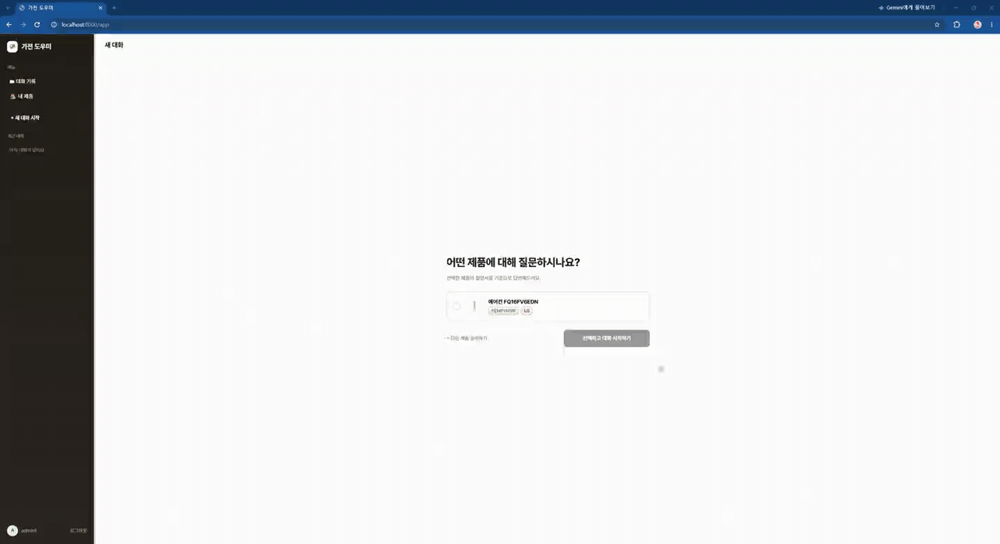
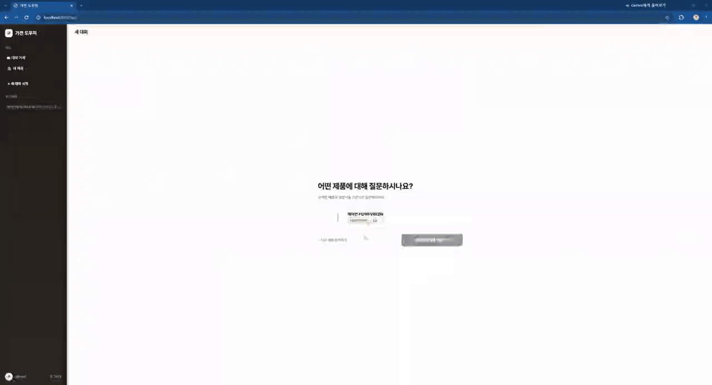
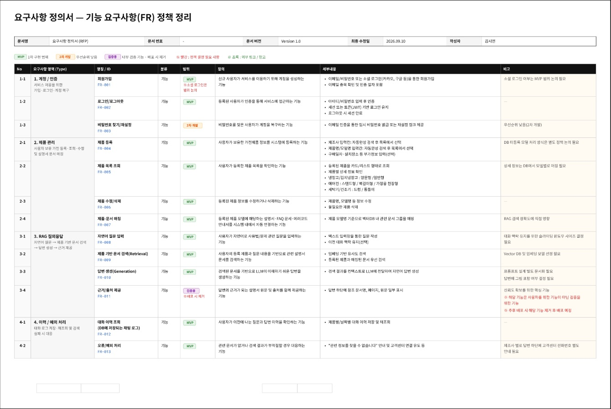
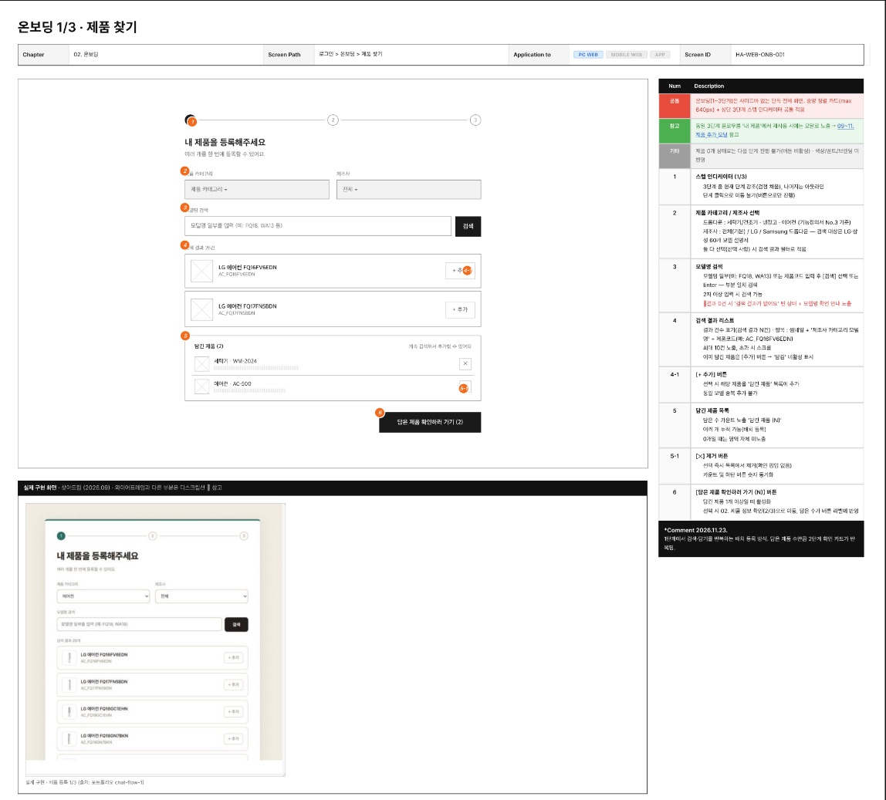
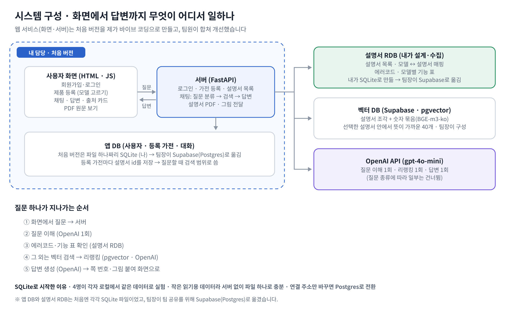
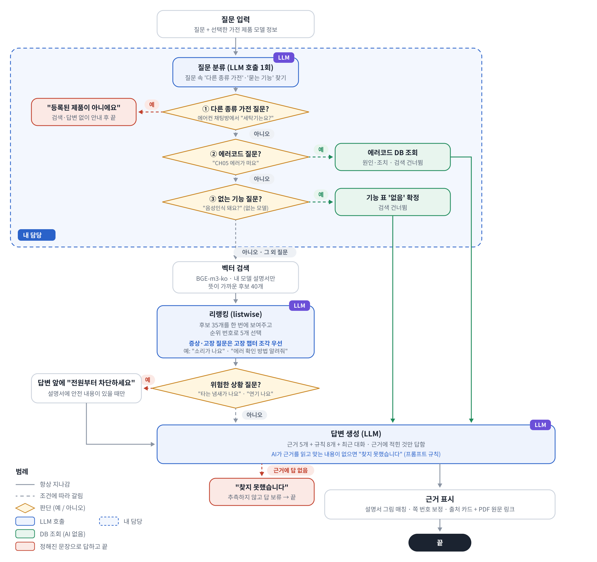
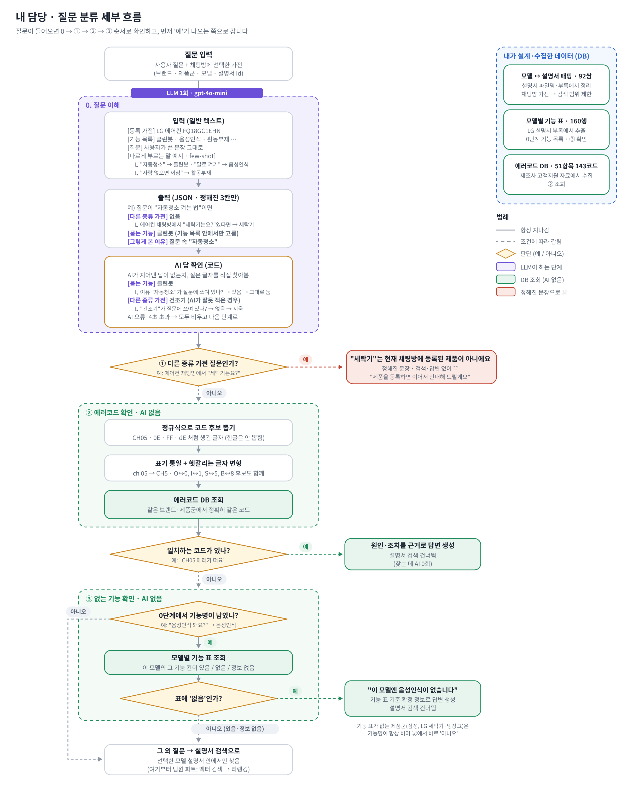
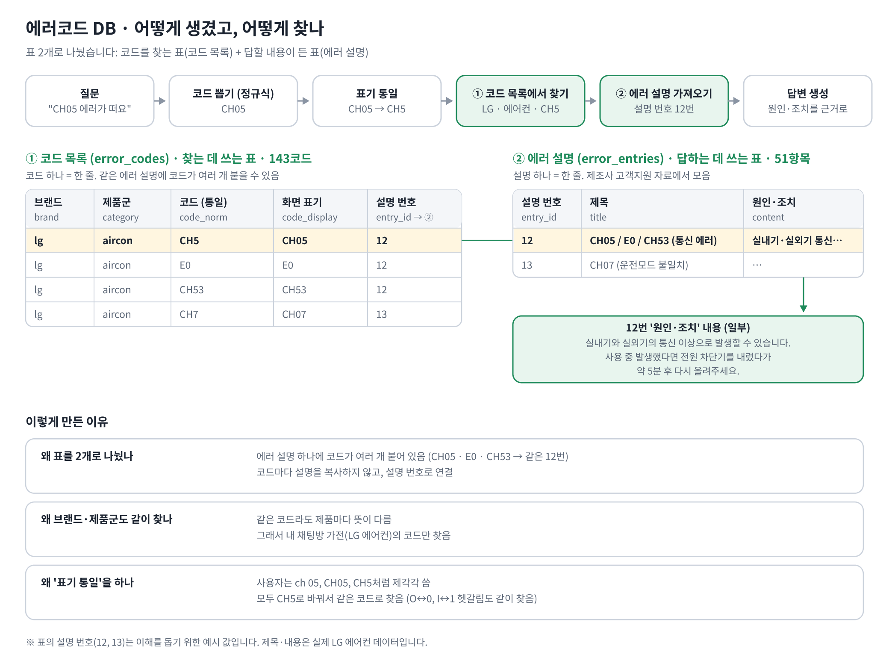
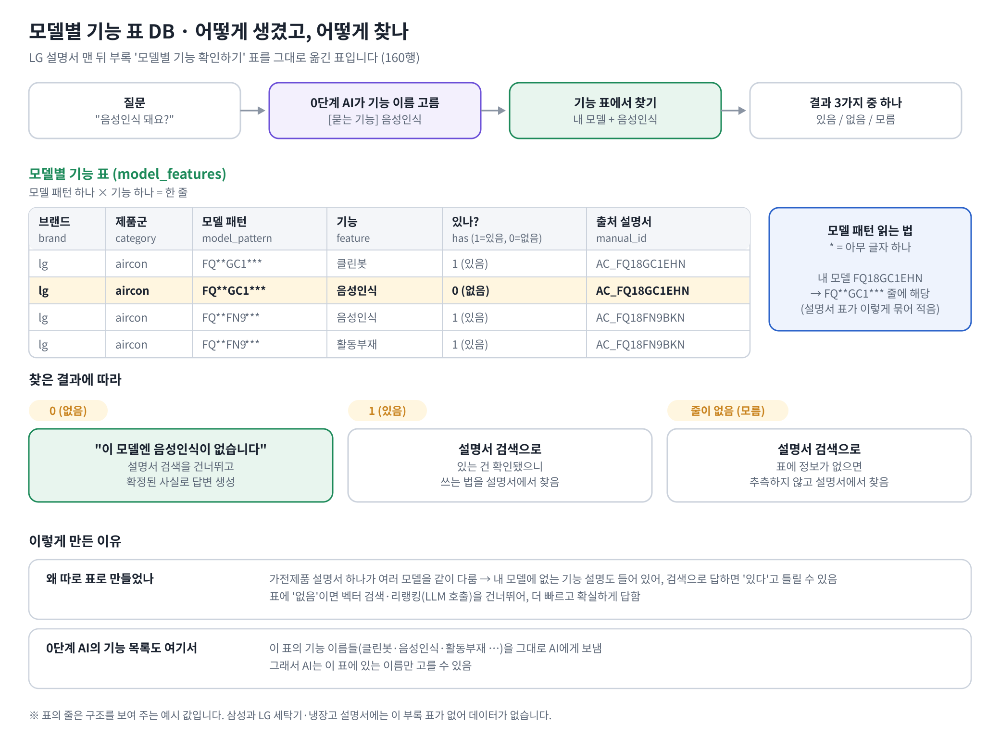
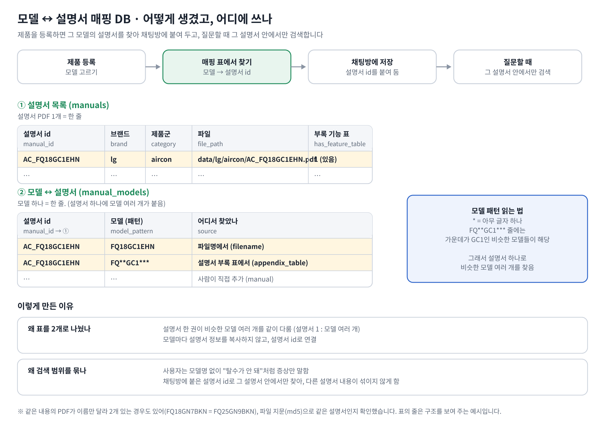

# 찾아드림 · 가전제품 설명서 RAG 챗봇 — 기획과 내 작업 정리

> LG CNS AI 캠퍼스 1조 **팀 프로젝트(4인)** 중 **제가 맡은 부분**만 모은 저장소입니다.
> 서비스 전체 코드는 팀 원본 저장소에 있습니다 → **[Broogun/ask-my-appliance](https://github.com/Broogun/ask-my-appliance)**

| 항목 | 내용 |
|---|---|
| 기간 | 2026.09.07 – 09.28 |
| 팀 | 4인 |
| 내 역할 | 서비스 기획 · RDB와 질문 흐름 설계 · 웹 서비스 바이브 코딩(백엔드·프론트엔드) |
| 당시 GitHub 계정 | [@siyeonkim99](https://github.com/siyeonkim99) (팀 프로젝트에서만 제가 따로 사용하는 계정입니다.) |
| 포트폴리오 | [찾아드림 상세 페이지](https://sikumdev.github.io/portfolio-v2/#chatbot) |

---

## 1. 어떤 서비스인가요?

LG·삼성 가전 60개 모델의 사용설명서를 검색해서 답하는 챗봇입니다.
답변마다 설명서 쪽 번호를 붙이고, 설명서에 근거가 없으면 지어내지 않고 "찾지 못했습니다"라고 답합니다.

| 에러코드 질문 | 일반 질문 |
|---|---|
|  |  |
| "CH05 떠요" → DB에서 원인·조치를 바로 답변 | 벡터 검색 · 리랭킹 → 설명서 그림까지 함께 답변 |

---

## 2. 기획 산출물 (내 담당)

개발에 들어가기 전에 요구사항 정의서, 기능정의서, 화면설계서를 Figma에 정리했습니다.

| 요구사항 정의서 | 화면설계서 |
|---|---|
|  |  |
| 기능 요구사항 13개를 MVP · 2차 개발 · 검증용으로 나눠 범위를 정함 | 화면마다 번호별 동작 설명을 달고 실제 구현 화면과 비교 |

---

## 3. 시스템 구성 · 질문 처리 흐름 · DB 설계 (내 담당)

에러코드나 "이 모델에 그 기능 있나요?"처럼 **답이 정해진 질문은 검색 없이 DB에서 바로** 답하도록 설계했습니다.

### 시스템 구성

웹 서비스(화면 · 서버) 첫 버전을 제가 바이브 코딩으로 만들고, 팀원이 합쳐 개선했습니다. 설명서 RDB는 제가 설계 · 수집해 SQLite로 만들었고, 이후 팀장이 Supabase로 옮겼습니다.

### 질문 처리 흐름

| 전체 흐름도 | 내 담당 · 질문 분류 세부 흐름 |
|---|---|
|  |  |

### DB 설계

| DB에 넣은 것 | 규모 | 쓰임 |
|---|---|---|
| 에러코드 | 143코드 (51항목) | 정규식으로 코드를 뽑아 원인·조치를 바로 찾음 (코드를 찾는 단계는 LLM 없이 처리) |
| 모델별 기능 표 | 160행 | 그 모델에 없는 기능이면 "없습니다"로 확정 |
| 모델 ↔ 설명서 | 92쌍 | 고른 가전의 설명서만 검색해 다른 모델 내용이 섞이지 않게 함 |

| 에러코드 DB | 기능 표 DB | 모델 ↔ 설명서 매핑 |
|---|---|---|
|  |  |  |

이 DB와 질문 흐름은 최종 서비스에 그대로 들어갔습니다.

---

## 4. 제가 작성한 코드 (팀 저장소 안)

| 무엇 | 위치 |
|---|---|
| 내 RAG 파이프라인 (청킹 · 검색 · 평가) | [`experiments/siyeon/`](https://github.com/Broogun/ask-my-appliance/tree/main/experiments/siyeon) |
| 설명서 목차 기반 청킹 (LG / 삼성 파서) | [`rag/chunking_lg.py`](https://github.com/Broogun/ask-my-appliance/blob/main/experiments/siyeon/rag/chunking_lg.py) · [`rag/chunking_samsung.py`](https://github.com/Broogun/ask-my-appliance/blob/main/experiments/siyeon/rag/chunking_samsung.py) |
| 에러코드 · 기능 표 DB 설계 | [`rdb/schema.sql`](https://github.com/Broogun/ask-my-appliance/blob/main/experiments/siyeon/rdb/schema.sql) · [`rdb/build_db.py`](https://github.com/Broogun/ask-my-appliance/blob/main/experiments/siyeon/rdb/build_db.py) |
| 웹 서비스 첫 버전 (FastAPI + 화면) | [커밋 f58f6ce](https://github.com/Broogun/ask-my-appliance/commit/f58f6ce) |
| 내 커밋 기록 | [@siyeonkim99의 커밋](https://github.com/Broogun/ask-my-appliance/commits?author=siyeonkim99) |

> 팀 저장소의 [`experiments/README.md`](https://github.com/Broogun/ask-my-appliance/blob/main/experiments/README.md)에도
> `siyeon/` = "CrossEncoder+RRF 파이프라인, 에러코드 RDB 설계"로 기록되어 있습니다.

---

## 5. 결과 (팀 결과 · AI 채점)

> 아래 수치는 모두 **AI가 채점한 결과**이며, 사람이 따로 검증하지는 않았습니다.

### 답변 안전성 — 900문항

| 지표 | 결과 |
|---|---|
| 근거 없이 확신한 답변 | **0건** |

60개 가전 제품 모델 × 5문항 × 3라운드 = 900문항의 답변을 AI 채점관(gpt-4o-mini)이 판정했습니다.

### 검색 정확도 — 104문항, 리랭킹 전후 비교

| 방식 | 어떻게 골랐나 | 정답이 5개 안에 든 질문 |
|---|---|---|
| 벡터 검색만 | 질문과 뜻이 가까운 순서대로 상위 5개를 그대로 사용 | 88 / 104 (**84.6%**) |
| 리랭킹까지 | 벡터 검색으로 후보 35개를 뽑고, AI(gpt-4o-mini)가 35개를 한 번에 읽고 비교해 5개를 다시 고름 | 96 / 104 (**92.3%**) |

- 벡터 검색만으로 놓친 **8문항을 리랭킹이 모두 되찾았고**, 리랭킹 때문에 새로 틀린 문항은 **0개**였습니다.
- **측정 방법** · 10개 가전제품 모델 × 15문항 = 150문항 중 설명서에 답이 있는 104문항만 사용했습니다. 후보 청크를 어느 방식에서 나왔는지 가린 채 섞어서, "이 청크만으로 답할 수 있다"고 판정된 청크를 정답으로 셌습니다. 판정은 AI(Claude)가 했습니다.
- 이 비교는 최종 채택된 팀원 방식 안에서 리랭킹의 효과를 잰 것입니다.

---

## 6. 내 방식과 최종 채택 방식

4명이 각자 RAG 파이프라인을 만들고, 팀 공통 평가(900문항)로 같은 조건에서 비교했습니다.
웹 서비스 첫 버전은 제 방식으로 동작했고, 실사용 점검 뒤 **청킹과 "후보 찾기 · 재정렬"만** 팀원 방식으로 바뀌었습니다.

### 검색 — 질문에 맞는 근거를 어떻게 골랐나

| 단계 | 내 방식 | 팀원 방식 | 최종 서비스 |
|---|---|---|---|
| 1. 질문 이해 | AI 1회로 기능 이름을 정리하고, 등록하지 않은 다른 제품 질문인지 판단 | AI가 질문을 작은 질문들로 나눔 | ✅ 내 방식 |
| 2. 검색 범위 정하기 | 등록한 모델 → 모델 ↔ 설명서 매핑 표로 그 모델 설명서만 검색 | 질문 속 브랜드 · 제품 · 모델명을 찾아 범위로 사용 | ✅ 내 방식 |
| 3. 에러코드 질문 | 질문에서 코드를 뽑아(CH05 · ch 05 · 0E/OE 표기 차이 정리) DB에서 정확히 찾고 1위로 고정. 코드 없이 "통신 에러래요"처럼 물어도 찾도록 같은 내용을 청크로도 저장 | 질문에서 코드를 뽑아 별도 DB에서 정확히 찾음 | ✅ 내 방식 |
| 4. "이 기능 있나요?" | 모델별 기능 표로 있음 / 없음 확정 | 없음 | ✅ 내 방식 |
| 5. 후보 찾기 | 본문 검색 + 청크마다 미리 만든 "예상 질문" 검색, 두 순위를 합침(RRF) → 후보 8개 | 본문 벡터 검색 → 후보 최대 40개 | 팀원 방식 |
| 6. 순서 다시 매기기 | 리랭커(bge-reranker)가 후보마다 점수를 매겨 상위 3개 | 후보 35개를 AI가 한 번에 비교해 선택 | 팀원 방식 |
| 7. 근거가 약할 때 | 관련도가 낮은 근거는 빼고, 남는 게 없으면 "설명서에 없다"고 답함 | 거리 기준 + 애매하면 AI가 한 번 더 확인 | ✅ 내 방식 |

### 청킹 — 설명서를 어떤 단위로 잘랐나 (최종 서비스: 팀원 방식)

|  | 내 방식 | 팀원 방식 |
|---|---|---|
| 기본 단위 | 목차 소제목 하나 = 청크 하나, 긴 절도 통째로 (예: 관리하기 › 청소하기 › 필터 청소하기) | 목차로 나눈 뒤 긴 절은 700자씩 다시 자름 (15% 겹침) |
| 고장 신고 표 | 증상 1개 = 청크 1개 (원인 · 해결책을 한 청크에) | 고장 챕터를 키워드로 찾아 증상별로 나눔 |
| 목차 없는 PDF | 번호 소제목 · 글자 크기로 제목을 찾고, 브랜드별 파서 2개(LG · 삼성) | 인쇄된 목차를 먼저 읽고, 안 되면 글자 크기로 나눔 |

### 바뀐 계기

세탁기 "탈수할 때 모터 소리가 나고 안 돌아가요" 질문에서 제 방식이 정답 청크를 놓친 사례가 나왔습니다.
본문 검색에서는 정답이 5위였지만, 예상 질문 쪽 점수가 낮아 두 순위를 합친 결과에서 밀려 후보 8개 안에 들지 못했습니다.
팀원 방식은 700자 청킹이 짧은 증상 항목들을 한 청크로 묶고 후보를 넓게 봐서 같은 질문에서 정답을 찾았습니다.

**배운 것** · 검색 점수를 여러 개 합치면 한쪽 점수가 낮을 때 정답이 밀릴 수 있고, 후보 수를 너무 좁히면 그걸 되살릴 기회도 사라진다는 걸 배웠습니다.

---

**기술 스택** · RAG · pgvector · BGE-m3-ko · gpt-4o-mini · FastAPI
